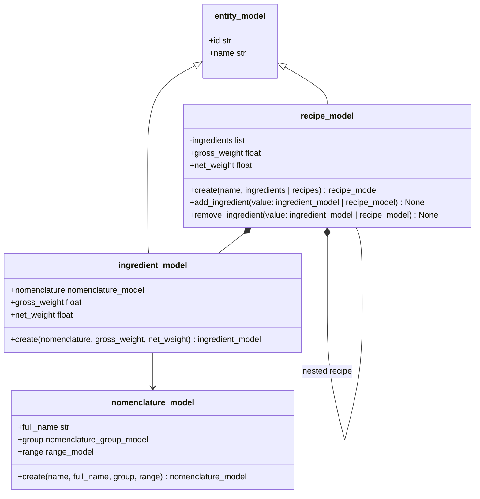

# UML-диаграмма моделей рецепта

`recipe_model` вычисляет веса брутто и нетто при обращении к свойствам,
рекурсивно обходя ингредиенты и вложенные технологические карты. Поэтому
добавление или исключение ингредиента на любом уровне сразу отражается на
итогах составного блюда. Циклическое вложение технологических карт запрещено.
